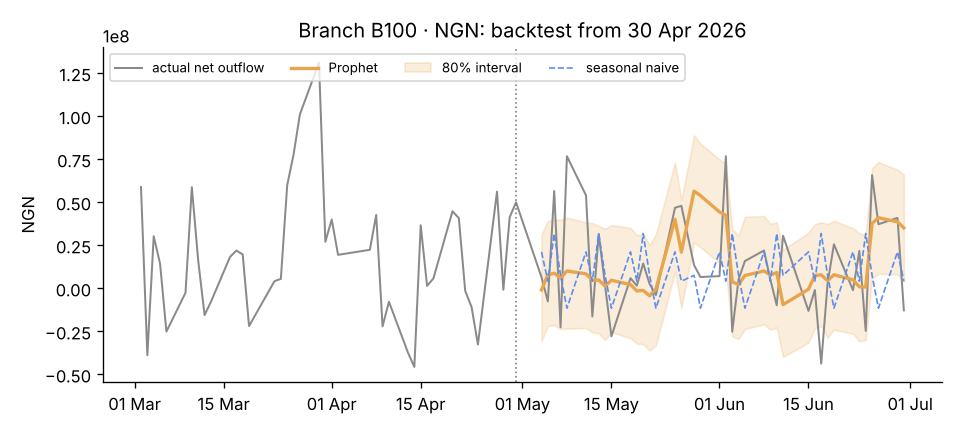
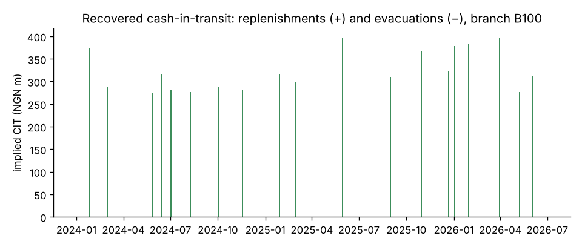

# Branch Cash Demand Forecasting (Prophet + Vault Position Layer)

[](https://github.com/SMLRE/branch-cash-forecasting/actions/workflows/ci.yml)

Forecasts daily customer cash demand **per branch and per currency (NGN, USD, GBP, EUR)** and combines it with vault balances from the general ledger to project each branch's **true cash position**. Vaults heading below their safe level are flagged for replenishment.

> **About the data.** This is a public re-implementation of a forecasting system I built and enhanced at a commercial bank. Teller and GL data are proprietary and are **not** in this repo. The code runs on synthetic data with the same structure, including two GL sources with different schemas. The "In production" section describes the real project. Results after it come from the synthetic data.



## In production (the real project)

| | |
|---|---|
| **Model** | **Facebook Prophet**, branch-level, across **four currencies: NGN / USD / GBP / EUR** |
| **Impact** | Improved branch cash-planning accuracy by **20–30%** |
| **Enhancement (Jun 2026)** | Integrated **vault balance data from two GL sources**: one for legacy branches and one for branches from an acquired bank. This produces **true cash-position** metrics, not just demand |
| **SQL** | Oracle solution using **`LAG()`** to derive the opening vault balance, plus a derived **`implied_cit`** residual column (cash-in-transit recovered from the ledger) |
| **Reliability fix** | The Oracle pipeline was restructured into **sequential staging tables**, which resolved recurring **ORA-01555 "snapshot too old"** failures |
| **Design recommendation** | Keep Prophet on **net customer flow** and put a **deterministic position-reconstruction layer** on top, rather than forecasting vault balances directly |

All five elements are reproduced in this repo.

## How it works

```
gl_vault_legacy ─┐
                 ├─ stg_01_vault_unified ── stg_02_opening_balance (LAG) ─┐
gl_vault_acquired┘                                                       ├─ stg_04_cash_position
teller_daily ──── stg_03_customer_flow ──────────────────────────────────┘     (+ implied_cit)
                                                                                     │
                                Prophet on net customer flow  ◄──────────────────────┘
                                          │
                     deterministic position layer: opening − Σ forecast outflow + planned CIT
                                          │
                                 replenishment alerts
```

* **Two ledgers:** different column names, branch-code formats, and alphabetic vs ISO-numeric currency codes, harmonised in `stg_01`.
* **Implied CIT:** `closing − opening + net_customer_outflow`. Replenishments and evacuations are not in teller data, so they are recovered from the ledger.
* **Prophet setup:** weekly + yearly seasonality, a month-end salary regressor, a December festive regressor, and Nigerian public holidays with a pre-holiday rush and post-holiday catch-up. Additive mode, because net flow crosses zero.



## Results on the synthetic reproduction

Backtest from 30 Apr 2026 over May–June, across **44 branch × currency series**, against a seasonal-naive benchmark (same weekday, last 4 weeks):

| Currency | Series | Prophet MAE / naive MAE (median) | 80% interval coverage |
|---|---|---|---|
| NGN | 20 | **0.78** (22% better) | 76% |
| USD | 8 | 0.90 | 75% |
| GBP | 8 | 0.92 | 70% |
| EUR | 8 | 0.93 | 75% |

* **86%** of series beat the benchmark, with a median MAE improvement of **15%**.
* The position layer, using forecast flow plus actual CIT, rebuilds the 10-day vault closing balance with a median error of about **10% of average vault size**.
* The live run from 30 Jun 2026 flags **12 vaults to replenish** within 5 business days.

NGN gains most because its drivers (salary month-end, festive season) are strong and regular. FX flows are lumpier.

## Run it

```bash
pip install -r requirements.txt
python run_pipeline.py        # ~1 minute: 88 Prophet fits
```

## Repo layout

```
data/generate_synthetic.py        branches, teller cash, two GL vault sources
sql/staging/stg_01..04_*.sql      sequential staging pipeline
src/pipeline.py                   runs the stages
src/forecast.py                   Prophet + holidays, naive benchmark, position reconstruction
run_pipeline.py                   backtest + live replenishment outlook
notebooks/walkthrough.ipynb
```

## Author

**Oluwasemilore Sadare**, Data Scientist · [LinkedIn](https://www.linkedin.com/in/oluwasemilore-sadare) · [GitHub](https://github.com/SMLRE)
